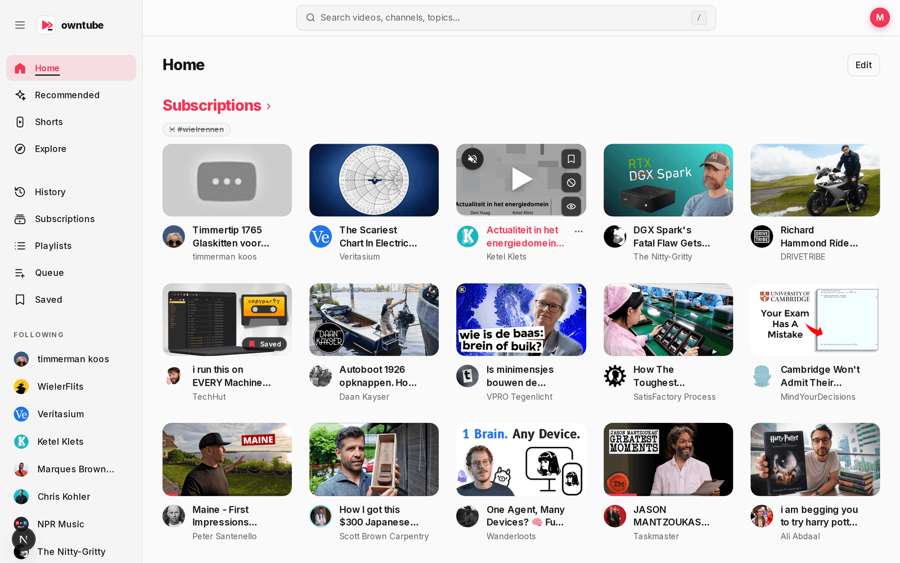
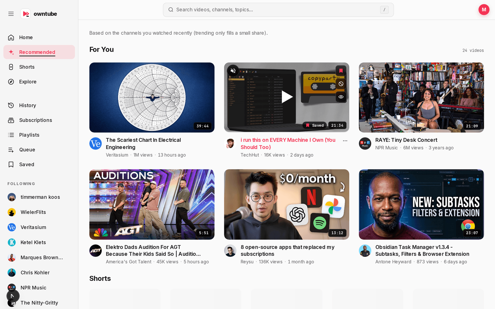
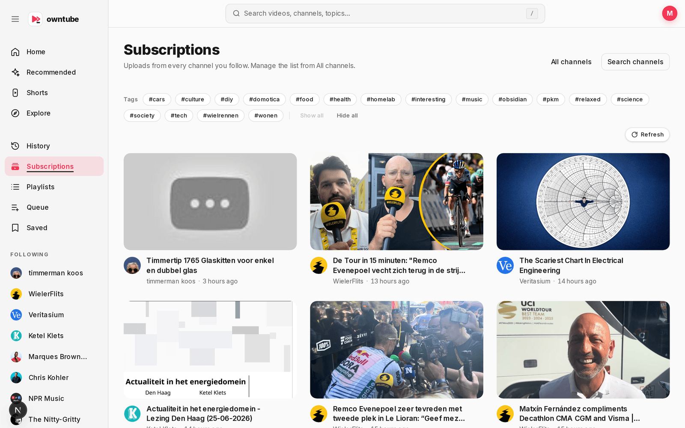
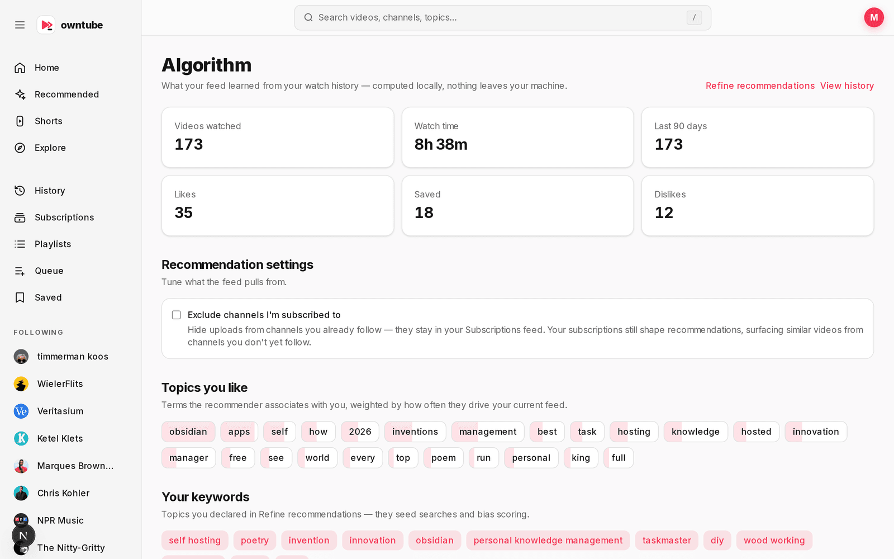
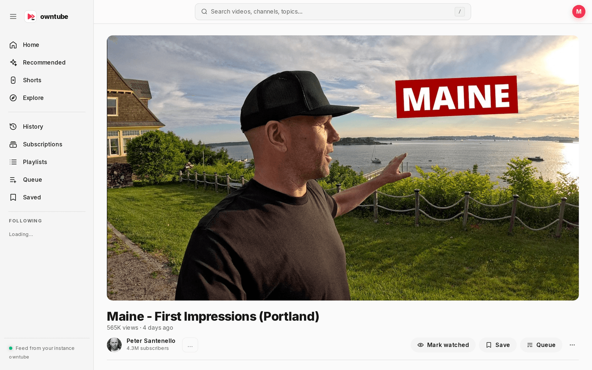
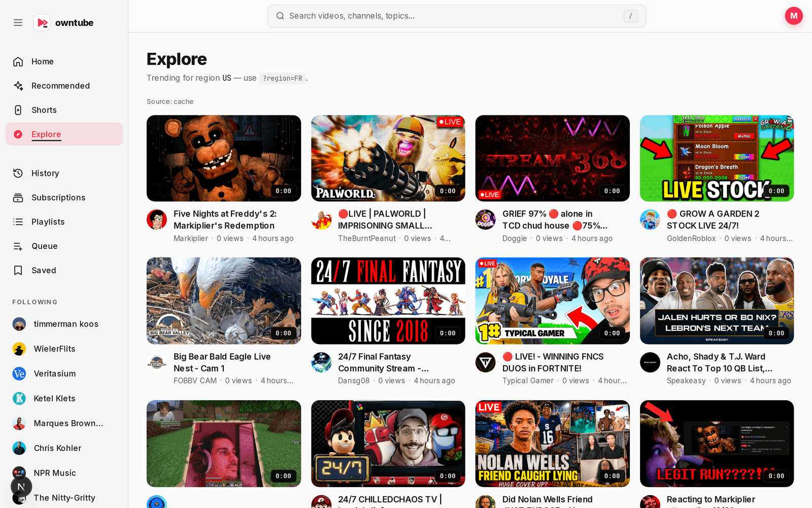

# OwnTube

Self-hosted, privacy-first YouTube frontend. No Google APIs, no tracking, no telemetry. Video metadata and streams come from OwnTube's own **YouTube gateway** (`apps/gateway`, the only process that talks to YouTube), and a small content-based recommender runs on top of your own watch history (stored locally in SQLite).

It's a solo side-project. Code is meant to stay maintainable by one person, so the stack is intentionally small and boring: Next.js 15 + TypeScript + tRPC + Drizzle + SQLite for the app, Node + Hono + youtubei.js for the gateway.



## Features

- **Customizable modular home** — reorderable blocks (subscriptions, recommended, explore, history, queue, saved, playlists) with per-block layout, size, tag filters, and color-coded headers
- Search, watch, history, like / dislike / save
- Personal recommendation feed (TF-IDF + MMR diversification, no collaborative filtering) with a local **Algorithm** dashboard, keyword refinement, and an option to keep already-subscribed channels out of recommendations
- Live page (YouTube's live streams), channel pages, subscriptions with merged feed and tri-state tag filters
- **Subscriptions tabs** — *Everything* (merged uploads), *By tag* (a lazily loaded row per channel tag) and *Channels*, with one tag filter and a "hide watched" toggle shared across tabs
- **Podcast feeds** — playlists, queue, saved, subscriptions, every subscribed channel and every channel tag are published as audio and video podcast RSS (with chapters) to a small public [feeds server](feeds/README.md), at an unguessable per-user secret address; *Copy RSS URL* on those pages and in their ⋯ menus
- **WebSub push** — new uploads from subscribed channels arrive via YouTube's hub within about a minute instead of on the next poll, and changed feeds are announced to podcast apps through OwnTube's own WebSub hub
- **API tokens** — revocable, scoped `ot_…` tokens for services that act on your behalf (e.g. syncing playback with a podcast app), created and revoked under Settings
- **One playback path** — the gateway serves signed DASH and HLS manifests for every video (VOD, live and DVR), up to 4K and with every dubbed audio track; it picks the transport itself (byte ranges, or SABR when YouTube refuses those) so the players don't have to
- **Captions everywhere** — a per-account default subtitle language, captions in Picture-in-Picture and native fullscreen, and caption tracks in the HLS stream for native players
- Auth.js (credentials + bcrypt), multi-user accounts
- Theme switcher, JSON export/import
- PiP and keyboard shortcuts in the player (Vidstack)
- **Android TV / Fire TV app** ([`apps/tv`](apps/tv/README.md)) — lean-back client with device pairing, profiles, the web home's rows and a D-pad player; *Play on TV* on the watch page sends a video to a paired TV
- Local playlists, dashboard stats, YouTube Takeout history import
- PWA (manifest + service worker)
- Docker Compose with healthcheck and restart policy

## Screenshots

|                                                                    |                                                                    |
| ------------------------------------------------------------------ | ------------------------------------------------------------------ |
| **Recommended** — personalized "For You" feed                      | **Subscriptions** — merged uploads with tri-state tag filters      |
| [](docs/screenshots/recommended.png) | [](docs/screenshots/subscriptions.png) |
| **Algorithm** — local recommender insights & settings              | **Watch** — Vidstack player                                        |
| [](docs/screenshots/dashboard.png) | [](docs/screenshots/watch.png) |
| **Explore** — regional trending                                    |                                                                    |
| [](docs/screenshots/trending.png) |                                                                    |

## Requirements

- Node.js 24+
- [corepack](https://nodejs.org/api/corepack.html) (ships with Node) for pnpm
- An IPv4 address YouTube doesn't block (the gateway reaches YouTube itself; whole IPv6 /64s get flagged faster)

This is a pnpm workspace: the web app lives in `apps/web/`, the YouTube gateway in `apps/gateway/`
(with `packages/youtube`, `packages/playback` and `packages/contracts`), the Android TV / Fire TV client in
`apps/tv/`, and a thin native iOS shell in [`apps/ios/`](apps/ios/README.md) — a WKWebView wrapper
that restores Picture-in-Picture and background audio, which iOS denies to the installed PWA.
Self-hosting needs `apps/web/` and `apps/gateway/`; the Docker images never contain TV or iOS code. The
root scripts below delegate to the web app via `pnpm --filter web`.

## Quick start

```bash
cp apps/web/.env.example apps/web/.env
corepack enable && corepack prepare pnpm@9.15.9 --activate
pnpm install
pnpm run db:migrate
pnpm dev:gateway   # in a second terminal: the gateway on :8080
pnpm dev
```

Open <http://localhost:3000>. Register an account on `/register` and you're in.

## Docker

```bash
docker compose up --build
```

Set `GATEWAY_SIGNING_KEY` and `AUTH_SECRET` in `.env` (compose runs the web app and the gateway). The SQLite database is persisted in the named volume `owntube-data`, the gateway's caches in `owntube-gateway`. Behind a reverse proxy, route `/media/*` to the gateway (port 8080); without one the web app forwards it.

For Unraid deployment, use `docker-compose.unraid.yml` + `.env.unraid` and follow [docs/UNRAID-DEPLOYMENT.md](docs/UNRAID-DEPLOYMENT.md).

## Routes

| Route                   | What                                              |
| ----------------------- | ------------------------------------------------- |
| `/`                     | Customizable modular home (signed-out → `/recommended`) |
| `/recommended`          | Personalized recommendation feed (falls back to Live) |
| `/live`                 | YouTube's live streams (`/trending` redirects here) |
| `/subscriptions`        | Subscribed channels + merged latest uploads       |
| `/channel/:channelId`   | Channel profile and videos                        |
| `/search`               | Video search                                      |
| `/watch?v=:videoId`     | Player + related videos                           |
| `/history`              | Watch history (signed-in)                         |
| `/playlists`            | Local playlists                                   |
| `/queue`, `/saved`      | Watch queue and saved videos                      |
| `/dashboard`            | Algorithm — recommender insights, keywords, settings |
| `/settings`             | Theme, API tokens, JSON export/import             |
| `/login`, `/register`   | Credentials auth                                  |

## Scripts

| Script              | Description                                         |
| ------------------- | --------------------------------------------------- |
| `pnpm dev`          | Next.js dev server (Turbopack)                      |
| `pnpm build`        | Production build                                    |
| `pnpm start`        | Production server                                   |
| `pnpm lint`         | Biome check                                         |
| `pnpm format`       | Biome format (write)                                |
| `pnpm typecheck`    | `tsc --noEmit`                                      |
| `pnpm db:migrate`   | Apply SQLite migrations                             |
| `pnpm db:generate`  | Regenerate migrations from the Drizzle schema       |
| `pnpm db:studio`    | Drizzle Studio                                      |
| `pnpm test`         | Vitest unit tests                                   |
| `pnpm test:watch`   | Vitest in watch mode                                |
| `pnpm test:e2e`     | Playwright (`e2e/`); first run: `pnpm exec playwright install` |

## Environment

All variables are documented in [apps/web/.env.example](apps/web/.env.example). The most important ones:

- `DATABASE_PATH` — SQLite file (default `./data/owntube.db`)
- `GATEWAY_URL` — the gateway's internal address (default `http://localhost:8080`)
- `GATEWAY_SIGNING_KEY` — shared by the web app and the gateway (API key and playback URL signatures)
- `GATEWAY_EGRESS_FAMILY` — on the gateway: `ipv4` (recommended), `ipv6` or `auto`
- `AUTH_SECRET` — Auth.js JWT secret (**must** be set in production)
- `LOG_LEVEL` — `debug` / `info` / `warn` / `error`

## Project layout

```
apps/
  web/                 Next.js app (users, feeds, recommendations, the player)
    src/server/catalog/    YouTube's catalogue, read from the gateway
    src/server/recommendation/  Reco engine: signals, TF-IDF, scoring, MMR
    src/server/db/         Drizzle schema + SQL migrations
  gateway/             Hono service: catalogue API (/api/*) and media (/media/*)
  tv/, ios/            Android TV / tvOS and iOS clients
packages/
  youtube/             InnerTube clients, sessions, SABR, catalogue parsing
  playback/            Track model, DASH/HLS writers, MP4/WebM indexes
  contracts/           The shared domain model, gateway client, URL signing
feeds/                 Public podcast feeds server + WebSub hub (see feeds/README.md)
docs/                  Plans and design notes (MONOREPO-PLAN.md: how this came to be)
```

## Tech stack

- **Framework**: Next.js 15 (App Router only)
- **Language**: TypeScript (strict)
- **UI**: Tailwind v4 + shadcn/ui (Radix), Vidstack player
- **State**: Zustand
- **API**: tRPC v11 + TanStack Query
- **DB**: SQLite via `better-sqlite3` + Drizzle ORM
- **Auth**: Auth.js v5 (Credentials + bcrypt)
- **Validation**: Zod
- **Tests**: Vitest + Playwright
- **Lint/format**: Biome
- **Package manager**: pnpm

## Contributing

PRs and issues are welcome. Please read [CONTRIBUTING.md](CONTRIBUTING.md) before opening one. For security-sensitive reports, see [SECURITY.md](SECURITY.md).

## License

MIT — see [LICENSE](LICENSE).

OwnTube started as a fork of [JasonBeucher/owntube](https://github.com/JasonBeucher/owntube) (MIT, © 2026 spookiss); that copyright notice is kept in [LICENSE](LICENSE) alongside the one for the work since.
